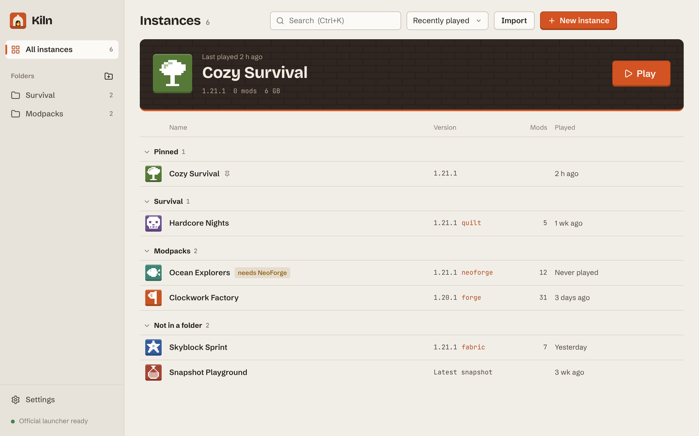
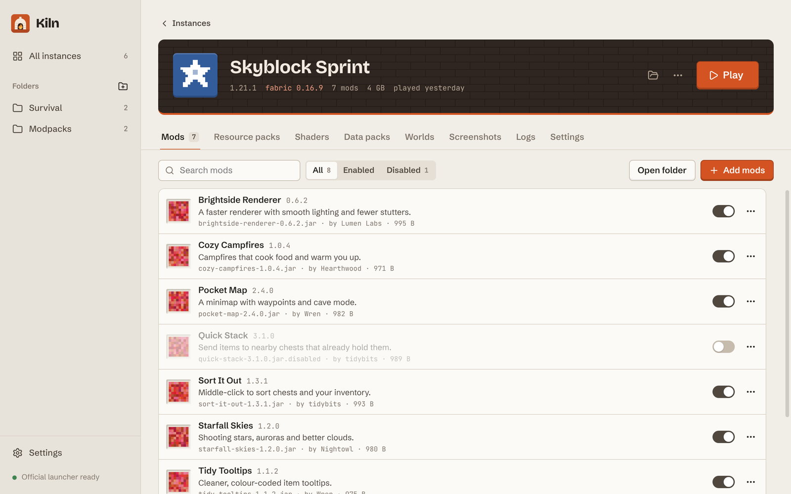
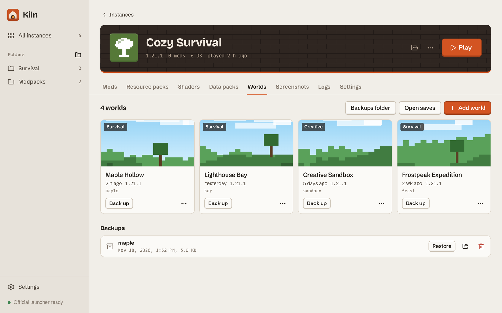
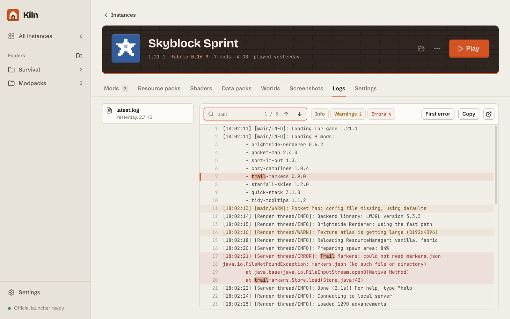
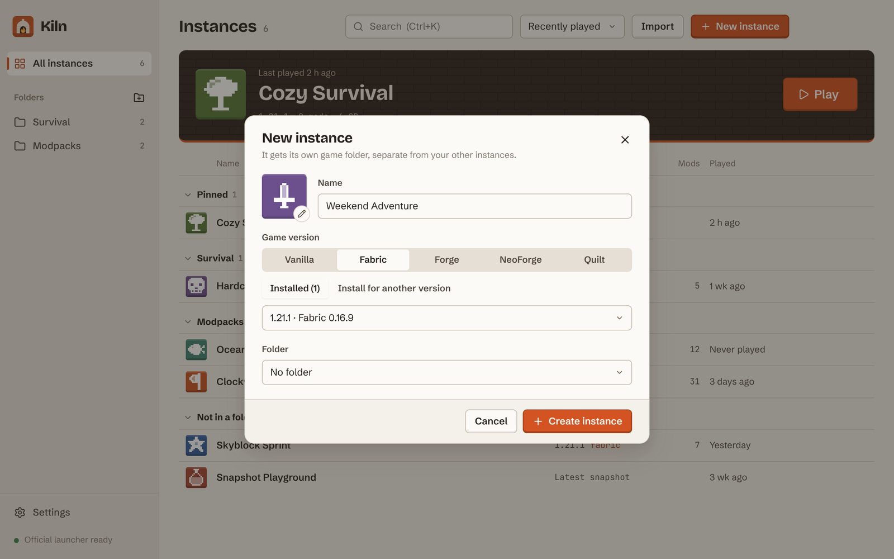

<div align="center">


# Kiln

Separate game folders for every modded setup, played through the official launcher.

[](https://github.com/aubergine-ux/kiln/releases/latest)
[](https://github.com/aubergine-ux/kiln/actions/workflows/ci.yml)
[](#download)
[](LICENSE)

<picture>
  <source media="(prefers-color-scheme: dark)" srcset="docs/screenshots/dark-home.png">
  
</picture>

</div>

I kept breaking my one `.minecraft` folder by swapping mods in and out, and I didn't want a launcher that signs in on its own, so Kiln gives every setup its own folder and leaves signing in and playing to the official launcher.

## Download

<a href="https://github.com/aubergine-ux/kiln/releases/latest/download/Kiln-Windows-Setup.exe"></a>
<a href="https://github.com/aubergine-ux/kiln/releases/latest/download/Kiln-macOS.dmg"></a>
<a href="https://github.com/aubergine-ux/kiln/releases/latest/download/Kiln-Linux.AppImage"></a>
<a href="https://github.com/aubergine-ux/kiln/releases/latest/download/Kiln-Linux.deb"></a>

You need the official launcher installed and opened at least once. The builds aren't signed yet, so Windows SmartScreen and macOS Gatekeeper will warn you the first time. On macOS, right-click Kiln and choose Open.

## What it does

- **Instances.** Create, duplicate, rename and delete them, sort them into folders, pin the ones you play most. Each one has its own mods, worlds, packs, settings and memory.
- **Play.** Kiln updates the instance's profile in the official launcher, selects it, and opens the launcher.
- **Mods.** Drag `.jar` files in. Kiln reads names, versions and icons from Fabric, Quilt, Forge and NeoForge jars. Turning a mod off renames it to `.jar.disabled`. Dropping a newer version of a mod replaces the old file.
- **Resource packs, shader packs and data packs.** Drag them in. Pack icons and descriptions come from the pack itself, colour codes included.
- **Mod loaders.** Pick Fabric, Forge, NeoForge or Quilt and Kiln links to the official installer, then notices when it's done.
- **Modpacks.** Import Modrinth `.mrpack` files and CurseForge `.zip` files. Files are downloaded from the links in the pack and checked against its SHA hashes. Export any instance as a pack your friends can import.
- **Worlds.** See them with their icons, back them up, restore backups and copy worlds between instances.
- **Screenshots and logs.** A gallery with copy and delete, and a log viewer with search, level filters and crash summaries.
- **Imports.** Copy instances over from Prism Launcher, MultiMC and the CurseForge app. The originals aren't touched.

Light and dark themes, five accent colours, and keyboard shortcuts for most things (press <kbd>?</kbd> in the app).

<table>
  <tr>
    <td width="50%">
      <picture>
        <source media="(prefers-color-scheme: dark)" srcset="docs/screenshots/dark-mods.png">
        
      </picture>
    </td>
    <td width="50%">
      <picture>
        <source media="(prefers-color-scheme: dark)" srcset="docs/screenshots/dark-worlds.png">
        
      </picture>
    </td>
  </tr>
  <tr>
    <td width="50%">
      <picture>
        <source media="(prefers-color-scheme: dark)" srcset="docs/screenshots/dark-logs.png">
        
      </picture>
    </td>
    <td width="50%">
      <picture>
        <source media="(prefers-color-scheme: dark)" srcset="docs/screenshots/dark-new-instance.png">
        
      </picture>
    </td>
  </tr>
</table>

## How it works

Kiln never signs in and never starts the game. Each instance is a folder with its own game directory. Kiln writes a matching profile into the official launcher's `launcher_profiles.json` (name, icon, version, game directory and memory) and copies that file to a backup before every change. Play marks the profile as most recently used and opens the launcher, which shows it ready on the Play tab.

That file is the only thing Kiln changes in the launcher's folder.

<details>
<summary><b>Where Kiln keeps things</b></summary>

<br>

| Platform | Folder |
| --- | --- |
| Windows | `%APPDATA%\Kiln` |
| macOS | `~/Library/Application Support/Kiln` |
| Linux | `~/.local/share/kiln` |

```
kiln/
  instances/
    my-instance/
      instance.json      name, version, loader, icon, folder, memory
      icon.png           also shown in the official launcher
      minecraft/         the game directory: mods, saves, resourcepacks, ...
  backups/
    launcher-profiles/   a copy of launcher_profiles.json before each change
    worlds/              world backups, one folder per instance
```

You can change the folder during first-run setup.

</details>

<details>
<summary><b>Building from source</b></summary>

<br>

You need Node.js 22 or newer.

```sh
npm install
npm run dev          # run with hot reload
npm test             # unit tests
npm run test:e2e     # end-to-end tests against a throwaway game folder
npm run dist         # build an installer for your platform into release/
```

`npm run screenshots` regenerates the images in this README from made-up demo data.

The code is Electron with Svelte 5 and TypeScript:

```
src/main/        file system, launcher profiles, imports, downloads
src/preload/     the bridge between the window and the main process
src/renderer/    the interface
src/shared/      types used on both sides
tests/           unit and end-to-end tests
```

</details>

## Roadmap

- CurseForge packs only list project numbers, so Kiln shows a list of mods to download by hand. I'd like to make that faster without needing an API key.
- Signed builds for Windows and macOS.
- Update notifications for Kiln itself.
- Checking for newer versions of installed mods.

## Not affiliated

Kiln is not affiliated with Mojang or Microsoft. Not an official Minecraft product. Not approved by or associated with Mojang or Microsoft.

## License

[MIT](LICENSE)
